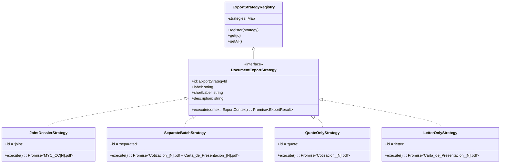

# 🏛️ Arquitectura Técnica y Manual de Ingeniería

Sistema de emisión, cálculo y exportación de cotizaciones y cartas de presentación oficiales para **M&C Construcciones Civiles S.A.S.**

---

## 1. Visión General del Sistema

El sistema implementa una arquitectura híbrida **Frontend-First / Modular** optimizada para despliegue en infraestructuras *Serverless Edge* (como **Vercel**), respaldada por un almacén de datos sin costo y de alta disponibilidad en **Google Sheets**.

```mermaid
flowchart TB
    subgraph Cliente["Cliente Web (React 19 + TypeScript + Tailwind CSS v4)"]
        UI["Consola Ergonómica de Captura de Obra (QuickForm)"]
        State["Hook useQuote (Estado React + Cálculos AIU)"]
        Strategy["Motor de Exportación (Patrón Strategy)"]
        Vault["Bóveda Offscreen 1:1 (#pdf-render-vault)"]
        Shim["Color Shim Acelerado (OKLCH / OKLAB a sRGB)"]
        PDF["html2canvas + jsPDF (Compilador A4)"]
    end

    subgraph Nube["Capa de Persistencia Serverless (Google Cloud)"]
        GAS["Google Apps Script (doPost / LockService)"]
        Sheet["Google Sheets (Cotizaciones - Base de Datos)"]
    end

    UI --> State
    State --> Strategy
    Strategy -->|"1. Asigna Consecutivo Atómico N°"| GAS
    GAS -->|"2. Candado Atómico y Append Row"| Sheet
    GAS -->>|"3. Consecutivo Oficial Confirmado"| Strategy
    Strategy --> Vault
    Vault --> Shim
    Shim --> PDF
    PDF -->|"4. Descarga Automática de Archivos"| Cliente
```

---

## 2. Principios y Patrones de Diseño Implementados

### A. Patrón Strategy para la Exportación de Documentos
Para cumplir con los diferentes requerimientos de entrega a clientes sin duplicar código ni generar acoplamientos, el sistema desacopla la exportación en 4 estrategias intercambiables definidas en `src/modules/quote/services/export-strategies/`:



| Estrategia | ID | Nomenclatura Estricta | Páginas Incluidas |
| :--- | :---: | :--- | :--- |
| **Dossier Unificado** | `joint` | `MYC_CC[N°].pdf` | Cotización completa + Carta de presentación en 1 solo archivo continuo. |
| **Ambos Separados** | `separated` | `Cotizacion_[N°].pdf` y `Carta_de_Presentacion_[N°].pdf` | Genera y descarga 2 PDFs independientes en 1 solo clic con pausa asíncrona de 350 ms. |
| **Solo Cotización** | `quote` | `Cotizacion_[N°].pdf` | Partidas de obra civil, subtotal, desglose AIU y firmas. |
| **Solo Carta** | `letter` | `Carta_de_Presentacion_[N°].pdf` | Propuesta epistolar A4 formal con valor en letras COP. |

---

### B. Normalizador de Color Acelerado por Hardware (`html2canvas-color-shim`)
* **El Problema:** Tailwind CSS v4 compila los colores (`slate-50`, `blue-900`, `amber-50`, etc.) utilizando espacios modernos **OKLCH / OKLAB**. La librería `html2canvas` (v1.4.1) arroja una excepción fatal al encontrarlos (`Error: Attempting to parse an unsupported color function "oklch"`), abortando la descarga.
* **La Solución:** `src/shared/utils/html2canvas-color-shim.ts` intercepta `window.getComputedStyle` y el contexto `onclone` del iframe temporal. Utiliza un micro-lienzo Canvas 2D en memoria con caché `Map` para convertir instantáneamente (< 1 ms) cualquier color OKLCH a valores estándar sRGB `rgb(...)` / `rgba(...)`.

---

### C. Concurrencia Atómica con Google Sheets y `LockService`
* **Garantía Inviolable:** No pueden existir dos cotizaciones con el mismo número bajo ninguna circunstancia.
* **Mecanismo:** En `google-apps-script/Code.gs`, la función `doPost(e)` solicita un candado global de script con `LockService.getScriptLock()`. Espera hasta 10 segundos, consulta el número más alto en la columna A, calcula `MAX(A) + 1`, inserta la fila del cliente con sus datos, y libera el candado antes de responder.
* **Resultado:** Consecutivos 100% continuos e incrementales sin servidores de base de datos intermedios que se apaguen por inactividad.

---

### D. Formateador de Texto y Ortografía Corporativa (`text-formatter.ts`)
* **Preservación de Siglas:** Normaliza entradas a *Title Case* o *Sentence Case* respetando siglas empresariales colombianas: `S.A.S.`, `S.A.`, `LTDA`, `E.U.`, `NIT`, `C.C.`, `M&C`.
* **Disparadores `onBlur`:** Formatea automáticamente los nombres de clientes, obras, ubicaciones y descripciones de ítems en el formulario sin interrumpir la escritura del operario.

---

## 3. Estructura de Directorios del Proyecto

```
MYC/
├── assets/                                   # RECURSOS ORIGINALES Y PLANTILLAS MAESTRAS
│   ├── branding/                             # Logotipos y vectores fuente de la empresa
│   │   ├── Logo-myc.jpg.jpeg
│   │   └── svg-logo.svg
│   └── templates/                            # Vectores maestros de diseño (Canva / Illustrator)
│       ├── Agente.svg                        # Plantilla oficial de cotización de obra
│       └── Plantilla-carta-de-presentacion.svg # Plantilla oficial de carta epistolar
│
├── docs/                                     # DOCUMENTACIÓN TÉCNICA Y OPERATIVA
│   ├── ARQUITECTURA.md                       # Este documento
│   ├── GUIA_DESPLIEGUE_VERCEL.md             # Guía paso a paso para desplegar en Vercel
│   └── GOOGLE_SHEETS_SETUP.md                # Manual de configuración de base de datos
│
├── google-apps-script/                       # CÓDIGO BACKEND SERVERLESS (GOOGLE DRIVE)
│   └── Code.gs                               # Webhook con LockService para Google Sheets
│
├── public/                                   # ASSETS ESTÁTICOS SERVIDOS POR LA WEB APP
│   ├── logo-myc.png                          # Logo optimizado consumido por MCLogo
│   ├── logo-myc.svg                          # Vector web
│   └── Agente.svg                            # Plantilla web
│
├── server/                                   # BACKEND MODULAR NODE.JS (EXPRESS + GEMINI AI)
│   ├── config/env.config.ts                  # Variables de entorno
│   ├── modules/ai-agent/                     # Asistente de IA para extracción de partidas
│   ├── routes/api.routes.ts                  # Enrutador API
│   └── index.ts                              # Entrypoint del servidor
│
├── src/                                      # FRONTEND REACT 19 + TAILWIND CSS V4
│   ├── modules/
│   │   ├── quote/                            # DOMINIO DE COTIZACIONES
│   │   │   ├── components/                   # QuickForm, QuoteDocument, PresentationLetterDocument...
│   │   │   ├── hooks/                        # useQuote, useQuotePdf
│   │   │   ├── services/                     # quote-calculator, quote-paginator, google-sheets.service
│   │   │   │   └── export-strategies/        # Patrón Strategy (4 modalidades de descarga)
│   │   │   └── types/                        # QuoteData, QuoteItem, QuoteTotals
│   │   └── mailer/                           # DOMINIO DE CORREO Y MENSAJERÍA
│   │       └── components/EmailModal.tsx     # Generador de mailto y enlace WhatsApp
│   │
│   ├── shared/                               # UTILIDADES COMPARTIDAS
│   │   ├── components/                       # MCLogo, Toast
│   │   └── utils/                            # currency.ts, text-formatter.ts, html2canvas-color-shim.ts
│   │
│   ├── App.tsx                               # Orquestador visual
│   ├── main.tsx                              # Punto de montaje React 19
│   └── index.css                             # Estilos Tailwind CSS v4 y reglas @media print
│
├── .env.example                              # Plantilla de variables de entorno
├── package.json                              # Dependencias y scripts npm
├── tsconfig.json                             # Configuración estricta TypeScript
└── vite.config.ts                            # Configuración del bundler Vite
```
